## 4 RESULTADOS E DISCUSSÃO

Este capítulo apresenta os resultados obtidos nos cenários descritos na Metodologia e os interpreta à luz do referencial teórico. Os valores oficiais de vazão e latência são do patamar de 10 minutos de cada execução (aquecimento, rampa e descida excluídos) e provêm de 15 execuções do teste de carga de 15 minutos (3 repetições de cada um dos cenários A, B, C, D e E) e de dois testes longos de 30 minutos de patamar (cenários C e D). As figuras extraídas do Grafana e do painel do k6 (Figuras 5 a 12) vêm de uma execução adicional de cada cenário, feita apenas para captura, e não entram nas médias.

### 4.1 Validação do ambiente e persistência de estado

Em todas as execuções válidas, as verificações (*checks*) do k6 passaram e a taxa de falhas HTTP foi de 0,00%, o que indica que as diferenças de desempenho adiante não decorrem de erros de aplicação.

Os endpoints `/memory` e `/db` revelam o que cada arquitetura realmente preserva entre requisições. O Quadro 1 resume as verificações feitas: cinco requisições sequenciais em cada cenário A, B e E, e 200 requisições sequenciais e 200 concorrentes nos cenários C e D, com 1 e com 4 *workers*.

**Quadro 1 – Estado preservado entre requisições, por cenário**

| Cenário | `/memory`: contador | `/db`: conexão PostgreSQL |
|---|---|---|
| A – CI4 + PHP-FPM | sempre 1; PID do processo varia (8, 10, 8, 10, 8) | nova a cada requisição (PIDs 40 a 44) |
| B e E – CI4 + FrankenPHP clássico | sempre 1; PID 1 | nova a cada requisição (PIDs 40 a 44) |
| C – CI4 + FrankenPHP Worker | cresce (2 a 201 em um *worker*); cada *worker* tem o seu contador | mantida: um único PID por *worker* (um *worker*: PID 70; quatro: PIDs 40, 48, 49 e 50) |
| D – Laravel Octane | cresce (2 a 201 em um *worker*); cada *worker* tem o seu contador | mantida: um único PID por *worker* |

Fonte: elaborado pelo próprio autor (2026), a partir de `results/diagnostico`.

O Quadro 1 mostra que os dois cenários em modo Worker (C e D) preservam tanto o estado da aplicação quanto a conexão com o banco, ao passo que A, B e E reiniciam ambos a cada requisição. Com quatro *workers*, os pedidos concorrentes são distribuídos entre quatro processos persistentes, cada um com seu contador e sua conexão, de modo que o contador global não é compartilhado entre eles. No cenário D com quatro *workers*, o diagnóstico registrou cinco identificadores de *worker* e, com um *worker*, dois; o padrão (um *worker* encerrado após cerca de 500 requisições e substituído por outro) é coerente com o reciclo periódico de processos que o Laravel Octane faz por padrão, e não ocorreu no CodeIgniter 4. A diferença entre os dois comportamentos é relevante para a memória, tratada na Seção 4.5.

### 4.2 Vazão (requisições por segundo) e latência

A Tabela 1 e a Figura 1 apresentam a vazão média e o desvio-padrão das três execuções de cada cenário, medidas no patamar de 10 minutos sob 100 usuários virtuais simultâneos (a vazão observada nessa carga, não necessariamente a capacidade máxima de cada cenário), em um orçamento de 1,0 CPU e 512 MB por cenário, e a latência global das requisições.

**Tabela 1 – Vazão e latência global por cenário (média das 3 execuções)**

| Cenário | RPS (média ± dp) | Latência p50 (ms) | Latência p95 (ms) | Latência p99 (ms) | Erros (%) |
|---|---|---|---|---|---|
| A – CI4 + PHP-FPM | 143,2 ± 0,6 | 698,2 | 789,7 | 807,2 | 0,00 |
| B – CI4 + FrankenPHP clássico | 155,8 ± 1,6 | 618,0 | 743,2 | 793,2 | 0,00 |
| E – CI4 + FrankenPHP clássico (*threads* padrão) | 176,4 ± 1,8 | 563,3 | 676,1 | 734,3 | 0,00 |
| C – CI4 + FrankenPHP Worker | 303,9 ± 2,1 | 309,8 | 397,9 | 408,3 | 0,00 |
| D – Laravel Octane | 336,9 ± 1,0 | 298,2 | 383,6 | 399,7 | 0,00 |

Fonte: elaborado pelo próprio autor (2026), a partir dos resumos do k6. Nota: RPS (requisições do patamar divididas por 600 s) e percentis calculados no patamar de 10 minutos, sem aquecimento, rampa e descida.

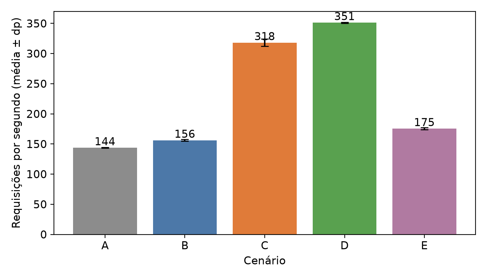

**Figura 1 – Vazão média (RPS) por cenário, com desvio-padrão das 3 execuções.** Fonte: elaborado pelo próprio autor (2026).

Em relação ao cenário A, o modo clássico do FrankenPHP (B) apresentou vazão 8,8% maior, o Worker com CodeIgniter 4 (C) apresentou vazão 112,2% maior (cerca de 2,1 vezes) e o Laravel Octane (D) apresentou vazão 135,2% maior (cerca de 2,4 vezes). Entre C e B, que usam o mesmo servidor e o mesmo número de unidades de concorrência, a diferença é de 95,0% a favor de C. A latência acompanha a vazão: o p95 do cenário C é 49,6% menor que o do A (397,9 contra 789,7 ms) e o p99, 49,4% menor (408,3 contra 807,2 ms). O desvio-padrão entre execuções do mesmo cenário ficou entre 0,3% e 1,0% da média, muito menor que as diferenças entre cenários.

A Tabela 2 reúne os testes estatísticos. A análise de variância (ANOVA) indicou diferença entre os cinco cenários na vazão (F = 10.524,5; p < 0,001), no p95 (F = 550,7; p < 0,001) e no p99 (F = 855,2; p < 0,001). Nos testes t de Welch par a par, com correção de Bonferroni para as seis comparações, todas as diferenças de vazão permaneceram significativas ao nível de 5%, inclusive a de D sobre C (+10,9%; p ajustado = 0,001). No p95, as diferenças de B sobre A (p ajustado = 0,65) e de E sobre B (0,24) não foram significativas, e no p99 tampouco (B sobre A, p ajustado = 0,76; E sobre B, 0,23). Com apenas três execuções por cenário, o poder dos testes é limitado e a normalidade não pode ser verificada; por isso os valores de p devem ser lidos como reforço à diferença de ordem de grandeza entre os cenários, e não como critério isolado.

**Tabela 2 – Comparações par a par (testes t de Welch, n = 3)**

| Comparação | Vazão (%) | p ajust. | p95 (%) | p ajust. | p99 (%) | p ajust. |
|---|---|---|---|---|---|---|
| B contra A | +8,8 | 0,013 | −5,9 | 0,65 | −1,7 | 0,76 |
| E contra B | +13,2 | 0,001 | −9,0 | 0,24 | −7,4 | 0,23 |
| C contra A | +112,2 | < 0,001 | −49,6 | < 0,001 | −49,4 | < 0,001 |
| C contra B | +95,0 | < 0,001 | −46,5 | 0,014 | −48,5 | 0,001 |
| C contra E | +72,3 | < 0,001 | −41,1 | 0,004 | −44,4 | 0,011 |
| D contra C | +10,9 | 0,001 | −3,6 | 0,003 | −2,1 | 0,037 |

Fonte: elaborado pelo próprio autor (2026), com `scripts/analyze.py`. Nota: variações percentuais da média do primeiro cenário em relação ao segundo; p ajustado pelo método de Bonferroni.

### 4.3 Latência por endpoint

A Tabela 3 e a Figura 2 detalham a latência média e o percentil 95 por endpoint, também no patamar.

**Tabela 3 – Latência por endpoint (média / p95, em ms)**

| Cenário | /health | /compute | /memory | /db |
|---|---|---|---|---|
| A – CI4 + PHP-FPM | 684,2 / 780,2 | 691,3 / 784,7 | 683,7 / 780,5 | 721,3 / 798,2 |
| B – CI4 + FrankenPHP clássico | 625,3 / 702,9 | 634,2 / 706,4 | 625,0 / 702,6 | 669,2 / 763,2 |
| E – CI4 + FrankenPHP clássico (*threads* padrão) | 558,7 / 667,2 | 562,9 / 670,6 | 558,9 / 666,5 | 579,4 / 688,5 |
| C – CI4 + FrankenPHP Worker | 324,3 / 396,1 | 336,2 / 400,4 | 324,1 / 396,2 | 326,1 / 396,7 |
| D – Laravel Octane | 291,6 / 379,1 | 304,4 / 388,9 | 291,4 / 378,6 | 294,1 / 381,2 |

Fonte: elaborado pelo próprio autor (2026).

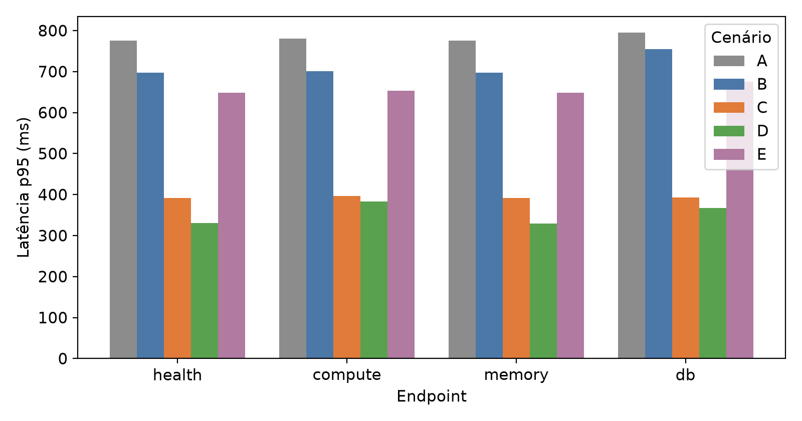

**Figura 2 – Latência p95 por endpoint e cenário.** Fonte: elaborado pelo próprio autor (2026).

Um achado importante é que a latência é praticamente a mesma nos quatro endpoints dentro de cada cenário, embora o `/health` não faça processamento e o `/compute` gere e serialize mil registros. A explicação é a forma de carga: o k6 mantém 100 usuários virtuais disparando requisições continuamente, sem tempo de espera entre elas, e o servidor, limitado a 1 CPU, está saturado (Seção 4.4). Nessa condição, o tempo de resposta é dominado pelo tempo de fila e, pela Lei de Little (LITTLE, 1961), a latência média em um sistema fechado aproxima-se de usuários ÷ vazão. A conta confere: 100 ÷ 143,2 ≈ 698 ms no cenário A (latência média medida: 697 ms), 100 ÷ 303,9 ≈ 329 ms no cenário C (328 ms) e 100 ÷ 336,9 ≈ 297 ms no cenário D (296 ms). Consequentemente, a latência aqui é um espelho da vazão, e não uma medida independente do custo de cada endpoint. A diferença entre `/db` e `/health` é pequena em todos os cenários: 37 ms no cenário A, 44 ms no B, 21 ms no E, 2 ms no C e 2,5 ms no D. Ela é maior nos cenários que abrem uma nova conexão a cada requisição (A, B, E) do que nos que a reaproveitam (C e D), o que é coerente com o Quadro 1, mas o desenho do experimento não isola o custo de cada endpoint com precisão. Para isso seria necessária carga com taxa de chegada fixa (modelo aberto), tema indicado nos trabalhos futuros.

### 4.4 Consumo de CPU e memória

**Tabela 4 – Consumo de recursos no patamar sustentado (média das 3 execuções)**

| Cenário | CPU média (% de 1 núcleo) | RAM média (MiB) | RAM pico (MiB) |
|---|---|---|---|
| A – CI4 + PHP-FPM (app + Nginx) | 92,7 ± 0,1 | 79,2 ± 0,0 | 80,6 |
| B – CI4 + FrankenPHP clássico | 100,2 ± 0,4 | 123,9 ± 0,2 | 124,9 |
| E – CI4 + FrankenPHP clássico (*threads* padrão) | 98,0 ± 1,7 | 119,7 ± 0,4 | 120,8 |
| C – CI4 + FrankenPHP Worker | 100,4 ± 0,4 | 125,4 ± 0,5 | 127,4 |
| D – Laravel Octane | 100,6 ± 0,0 | 171,6 ± 0,4 | 172,9 |

Fonte: elaborado pelo próprio autor (2026), a partir de amostras de `docker stats`. Nota: no cenário A, soma de PHP-FPM e Nginx.

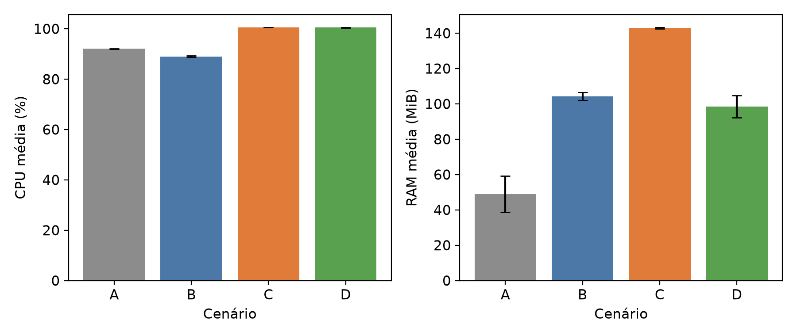

**Figura 3 – CPU e RAM médias por cenário.** Fonte: elaborado pelo próprio autor (2026).

Em todos os cenários a CPU ficou próxima do limite de 1,0 núcleo (92,7% a 100,6%), confirmando a saturação e que o gargalo do experimento é a CPU, e não a memória: nenhum cenário passou de 173 MiB, contra o limite de 512 MiB. Os cenários persistentes (C e D) usaram a mesma CPU que B e processaram mais requisições; ou seja, converteram o recurso em trabalho útil com mais eficiência, e não consumiram mais por requisição. O cenário A foi o único abaixo de 100%, o que pode refletir a divisão da cota entre PHP-FPM (0,85 CPU) e Nginx (0,15 CPU): como cada contêiner tem seu próprio limite, a capacidade ociosa de um não pode ser usada pelo outro. O PHP-FPM foi o mais econômico em memória (79 MiB), custo esperado de manter a aplicação carregada em memória nos demais: o CodeIgniter 4 em modo Worker usou 125 MiB (+46 MiB em relação ao A) e o Laravel Octane, 172 MiB.

### 4.5 Estabilidade da memória nos testes longos

Para verificar se a memória dos cenários persistentes cresce com o tempo, os cenários C e D foram executados com patamar de 30 minutos. A Tabela 5 e a Figura 4 mostram o resultado.

**Tabela 5 – Testes longos (patamar de 30 minutos) nos cenários C e D**

| Cenário | RPS | p95 (ms) | p99 (ms) | RAM nos 5 min iniciais (MiB) | RAM nos 5 min finais (MiB) | RAM pico (MiB) |
|---|---|---|---|---|---|---|
| C – CI4 + FrankenPHP Worker | 304,4 | 397,5 | 407,6 | 125,8 | 126,0 | 127,0 |
| D – Laravel Octane | 340,6 | 380,0 | 398,2 | 171,3 | 171,8 | 174,2 |

Fonte: elaborado pelo próprio autor (2026), a partir dos testes longos e de `docker stats`.

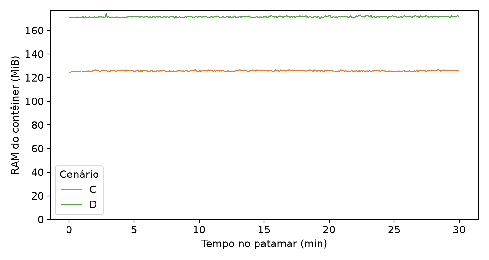

**Figura 4 – Memória dos contêineres C e D ao longo do patamar de 30 minutos.** Fonte: elaborado pelo próprio autor (2026).

Nos dois cenários a memória se manteve estável durante os 30 minutos, com variação de menos de 1 MiB entre o início e o fim do patamar, e a vazão e a latência ficaram no mesmo nível das execuções de 15 minutos (vazão 0,2% maior no C e 1,1% maior no D). Portanto, não houve evidência de acúmulo de memória nem de degradação de desempenho no modo Worker nem no CodeIgniter 4 nem no Laravel Octane, o que é relevante para a adoção do modo Worker em produção, em que o risco de vazamento entre requisições é a principal contrapartida (DUNGLAS, 2024). A estabilidade em 30 minutos, com 4 *workers*, não garante o mesmo comportamento em períodos de horas ou com aplicações mais complexas.

### 4.6 Visão temporal nas execuções de captura

As Figuras 5 a 8 mostram o painel do Grafana, e as Figuras 9 a 12 o painel de resumo do k6, de cada cenário em uma execução de captura. Elas ilustram o comportamento no tempo: rampa de usuários virtuais, patamar estável de vazão e latência, CPU constante no teto e erro em 0%. No painel do k6, a vazão alta do início da execução corresponde à fase de poucos usuários virtuais, em que as requisições são atendidas sem fila, e cai ao patamar sustentado quando a carga chega a 100 usuários.

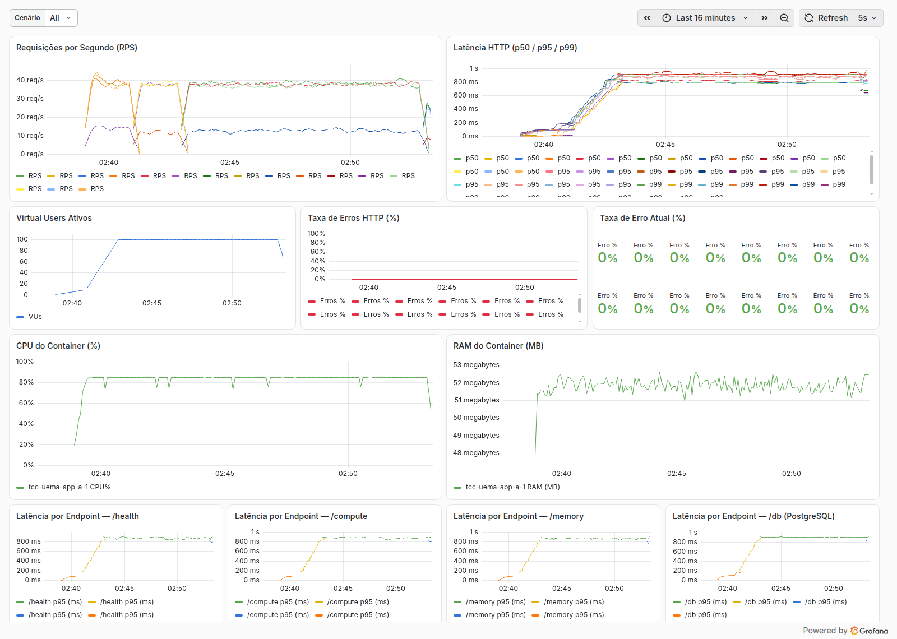

**Figura 5 – Painel do Grafana, cenário A (execução de captura).** Fonte: elaborado pelo próprio autor (2026).

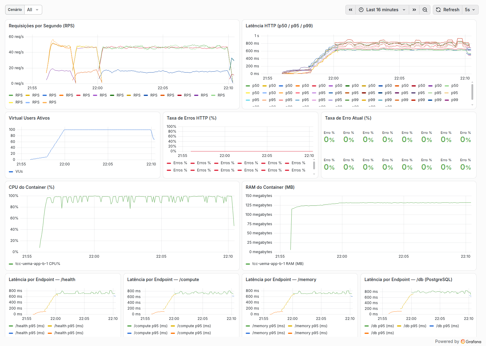

**Figura 6 – Painel do Grafana, cenário B (execução de captura).** Fonte: elaborado pelo próprio autor (2026).

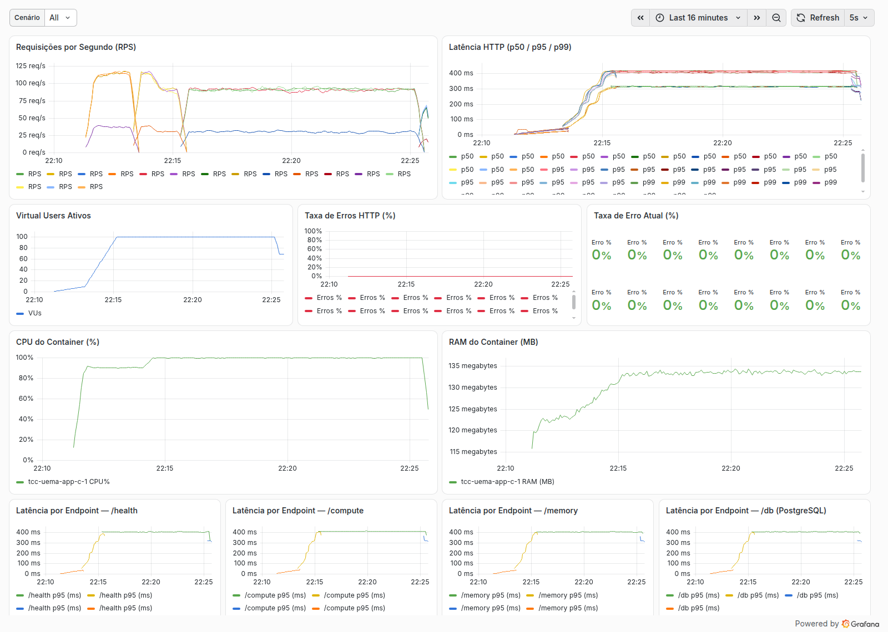

**Figura 7 – Painel do Grafana, cenário C (execução de captura).** Fonte: elaborado pelo próprio autor (2026).

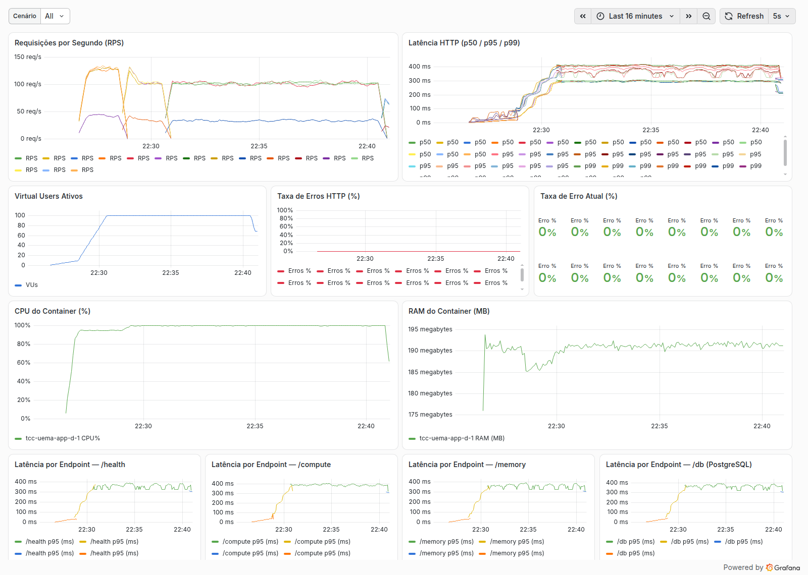

**Figura 8 – Painel do Grafana, cenário D (execução de captura).** Fonte: elaborado pelo próprio autor (2026).

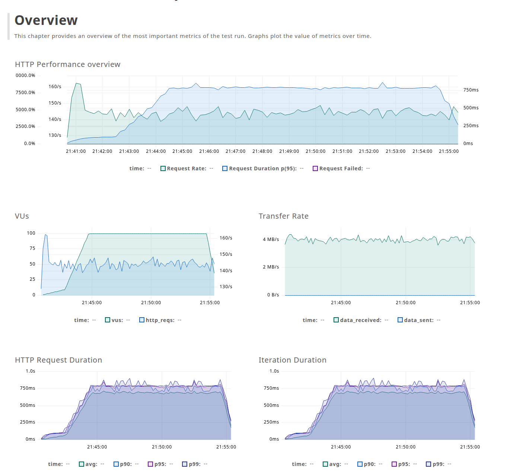

**Figura 9 – Painel do k6, cenário A (execução de captura).** Fonte: elaborado pelo próprio autor (2026).

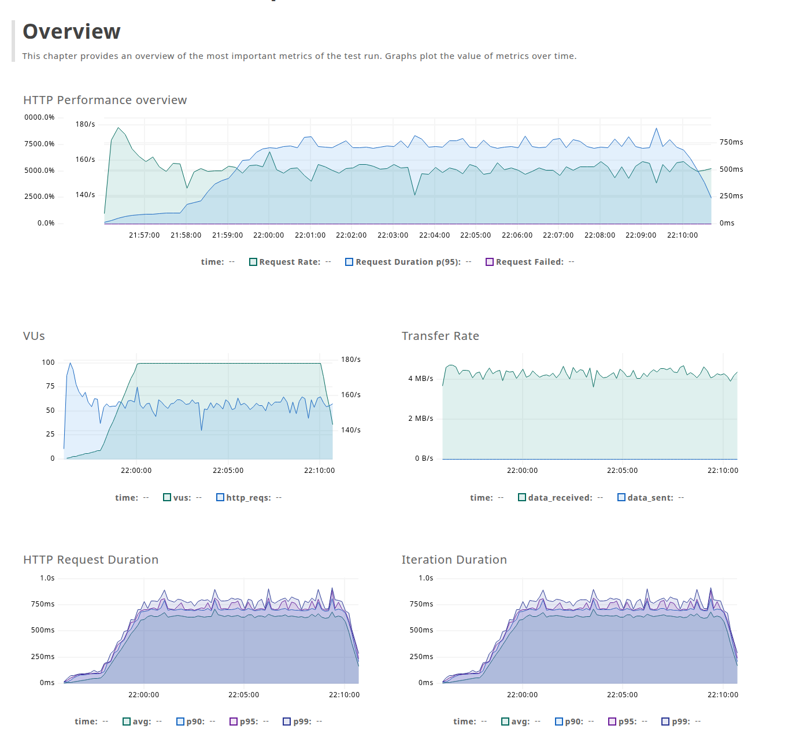

**Figura 10 – Painel do k6, cenário B (execução de captura).** Fonte: elaborado pelo próprio autor (2026).

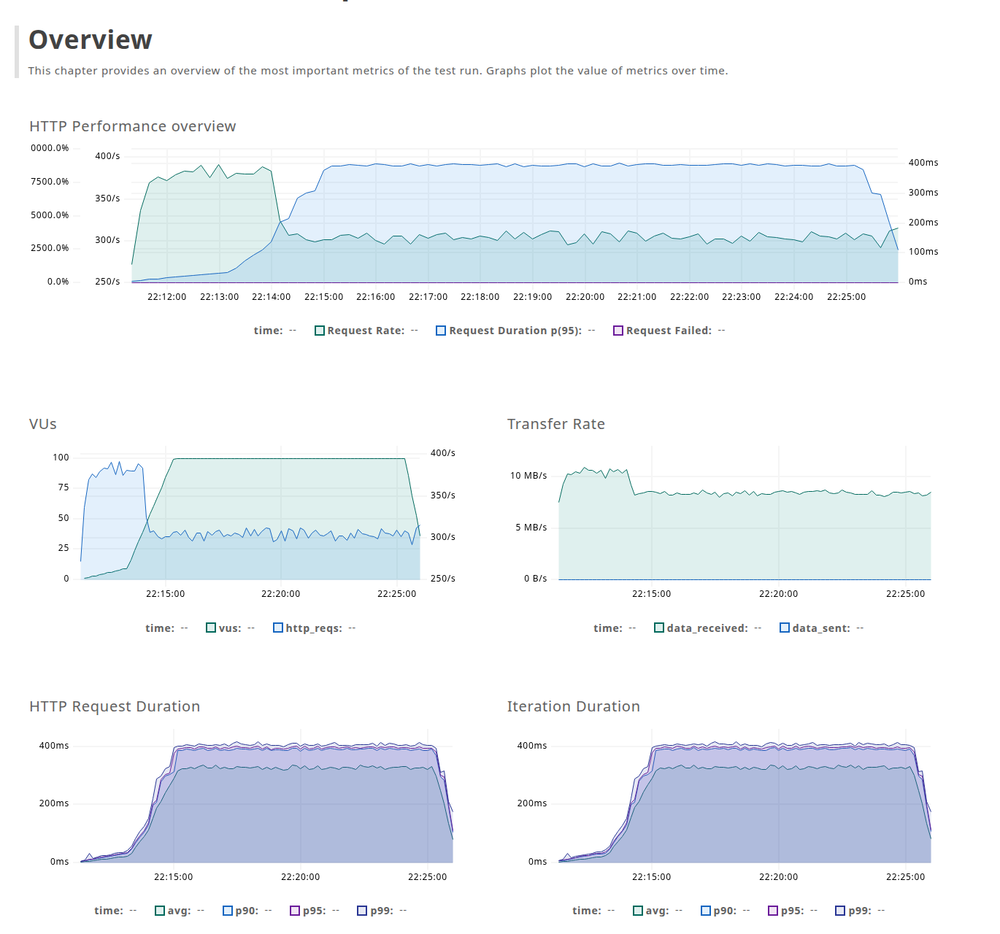

**Figura 11 – Painel do k6, cenário C (execução de captura).** Fonte: elaborado pelo próprio autor (2026).

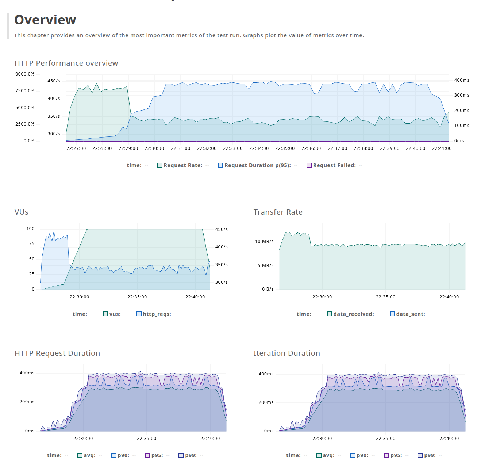

**Figura 12 – Painel do k6, cenário D (execução de captura).** Fonte: elaborado pelo próprio autor (2026).

### 4.7 Discussão

**Persistência do processo reduz o custo de inicialização.** O resultado mais forte do estudo é que manter o processo e o *framework* carregados em memória mais que dobrou a vazão do CodeIgniter 4 (C em relação a A, +112,2%) e reduziu pela metade o p95 e o p99, com os mesmos recursos e sem perda de estabilidade (Seção 4.5). Essa é a comparação entre duas arquiteturas completas (servidor, compilação do PHP e divisão de recursos diferentes); a comparação que mais isola o modo Worker é a de C com B, que usam o mesmo FrankenPHP e quatro unidades de concorrência (+95,0% de vazão). Isso é coerente com a motivação do trabalho: no modelo tradicional, a inicialização do *framework* se repete a cada requisição, e o modo Worker do FrankenPHP elimina essa repetição ao manter o processo vivo (DUNGLAS, 2024). O Quadro 1 mostra que, no CodeIgniter 4, o modo Worker preserva também a conexão com o banco e o estado da aplicação, de modo que o ganho decorre da soma da eliminação do *bootstrap* com o reaproveitamento da conexão; o experimento não separa as duas parcelas. Resultado semelhante em direção, ainda que em outro contexto, é relatado por Luz, Silva e Emer (2024), que encontraram vantagem estatisticamente significativa do modelo assíncrono do Swoole sobre o PHP síncrono tradicional em testes de carga, e por Azzahidi, Wijayanto e Darmawan (2025), que incluíram Laravel com FrankenPHP entre os *frameworks* avaliados e o destacaram pelo uso eficiente de memória. Nossos resultados complementam esses estudos ao isolar o efeito do servidor (B) do efeito do modo Worker (C) em um mesmo *framework*.

**Trocar apenas o servidor traz um ganho pequeno.** O FrankenPHP em modo clássico (B) superou o PHP-FPM (A) em 8,8% de vazão, mas não de modo significativo no p95 (−5,9%) nem no p99 (−1,7%), e ficou 49% abaixo do cenário C. O cenário B é a comparação mais direta com o A, pois ambos reiniciam estado e conexão a cada requisição (Quadro 1). Sem o cenário B, o ganho do cenário C poderia ser atribuído erroneamente ao FrankenPHP em si, quando decorre sobretudo do modo Worker. Neste experimento não investigamos a causa do pequeno ganho de B sobre A; uma hipótese é que o FrankenPHP dispensa o salto FastCGI entre Nginx e PHP-FPM e a divisão da cota de CPU entre dois contêineres (Seção 4.4), compensada em parte pelo uso de PHP *thread-safe*. O cenário de sensibilidade E, com o número padrão de *threads* do servidor, elevou a vazão em 13,2% em relação ao B, o que mostra que o resultado do modo clássico depende dessa configuração: mesmo assim, E ficou 42% abaixo do cenário C em vazão. A conclusão de que o modo Worker é o que determina o ganho vale, portanto, para as duas configurações do modo clássico.

**O CodeIgniter 4 em Worker ficou próximo do Laravel Octane, atrás dele.** O Laravel Octane (D) superou o CodeIgniter 4 em modo Worker (C) em 10,9% de vazão (336,9 contra 303,9 RPS) e 3,6% de p95, diferença menor que a que separa qualquer cenário clássico do modo Worker, mas significativa na vazão mesmo após a correção de Bonferroni (Tabela 2), e relativa a duas implementações específicas, sob uma carga e uma configuração particulares. O resultado diverge da expectativa implícita no problema de pesquisa, de que o CodeIgniter, por ser mais leve, aproveitaria melhor o modo Worker: ele ficou 9,8% abaixo do Octane, e com menos memória (125 contra 172 MiB, Tabela 4). Duas observações ajudam a interpretar: (i) o Octane é um pacote maduro, projetado para esse modelo de execução e que já trata a limpeza de estado entre requisições (OTWELL, 2024), enquanto o suporte nativo do CodeIgniter ao modo Worker é recente (CODEIGNITER FOUNDATION, 2024); e (ii) o diagnóstico mostrou que os dois preservam estado e conexão, de modo que a diferença remanescente não decorre da persistência da conexão. Não foi feito perfilamento do código, de modo que as causas permanecem hipóteses; o que os dados sustentam é a diferença de vazão, o comportamento da memória e a equivalência de estado preservado.

**Quanto a reprodutibilidade e benchmarking.** A decisão de repetir cada cenário três vezes, em ordem rotativa, de manter a mesma base de sistema operacional em todos eles e de reportar o desvio-padrão segue a recomendação da literatura de que benchmarks de software sofrem instabilidade e devem ser tratados com repetição e controle do ambiente (LAABER; BASMACI; SALZA, 2021), e a de que comparações de desempenho exigem condições idênticas de execução (ZHAN, 2022; BRUNST et al., 2022; JIA et al., 2013). O desvio-padrão baixo observado (no máximo 1,0% da média) indica que o ambiente conteinerizado, com limites estritos de CPU e memória, produziu medições estáveis.

### 4.8 Ameaças à validade e limitações

Os resultados devem ser lidos considerando as seguintes limitações do estudo:

a) **hospedeiro único e injetor no mesmo hospedeiro:** o k6 rodou na mesma máquina que os servidores (em contêiner com 2,0 CPU), o que pode causar interferência, embora igual entre cenários. Outros processos do computador do autor consumiam memória durante as medições;
b) **ordem das execuções:** os cenários A a D foram executados em ordem rotativa, mas o cenário E foi executado depois deles, e os testes longos por último; a temperatura do hospedeiro pode ter variado entre esses blocos;
c) **carga sintética e modelo fechado:** os endpoints são simples e a carga é de usuários virtuais sem tempo de espera, o que satura o servidor e torna a latência função da vazão (Seção 4.3). Os resultados não se estendem automaticamente a aplicações reais, com consultas mais complexas e uso de sessão;
d) **tamanho da amostra:** com três execuções por cenário, os testes estatísticos têm poder limitado e a normalidade não pode ser verificada; as diferenças de p95 e p99 de B sobre A e de E sobre B não são significativas;
e) **carga única:** a vazão foi medida apenas com 100 usuários virtuais, sem varredura de concorrência; por isso é a vazão observada nessa carga, e não se demonstra que seja o máximo de cada cenário;
f) **compilação do PHP:** o PHP do FrankenPHP é *thread-safe* e o do PHP-FPM não é, diferença inerente às arquiteturas que o experimento não separa do efeito do servidor;
g) **infraestrutura de medição não fixada:** as imagens do Prometheus, do Grafana, do cAdvisor e do k6 usam a etiqueta `latest`, ao contrário das imagens dos cenários, fixadas por versão e por *digest*. Elas são idênticas entre cenários, mas não garantem a reprodução bit a bit;
h) **causas não investigadas:** diferenças entre A e B e entre C e D foram interpretadas como hipóteses, sem perfilamento.
